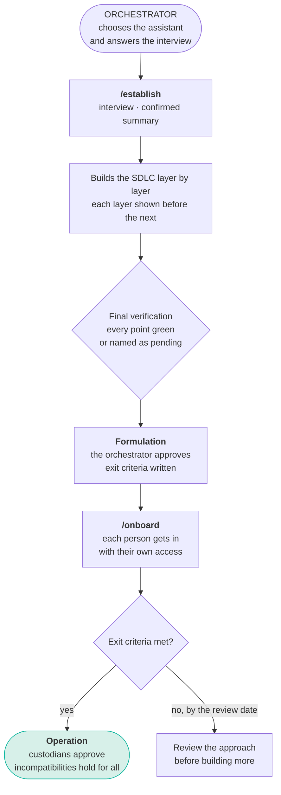
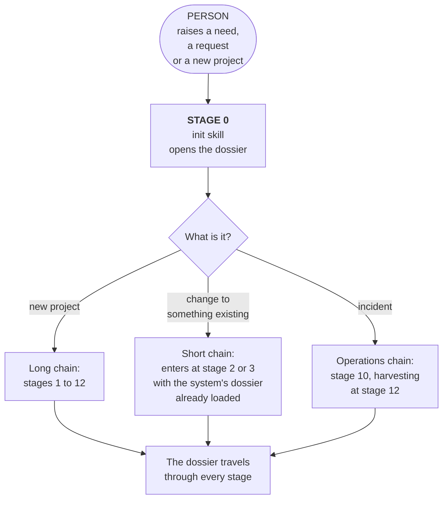
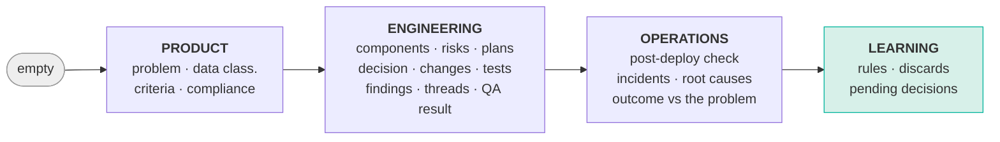
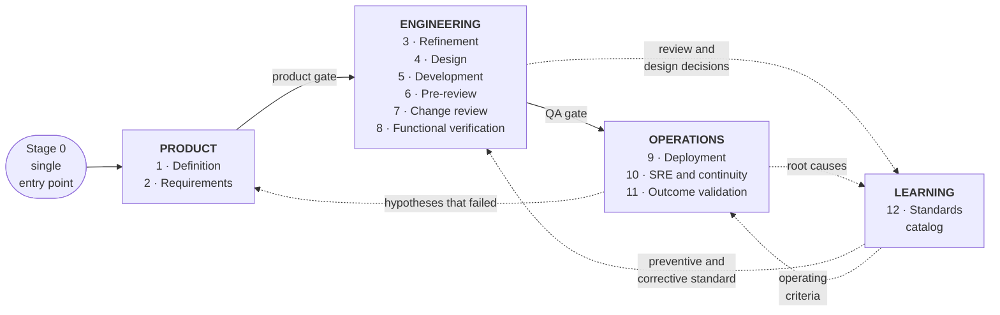
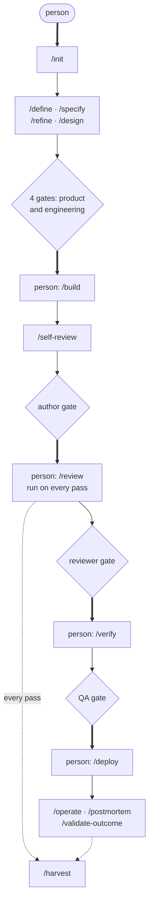
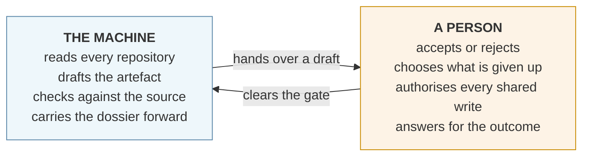
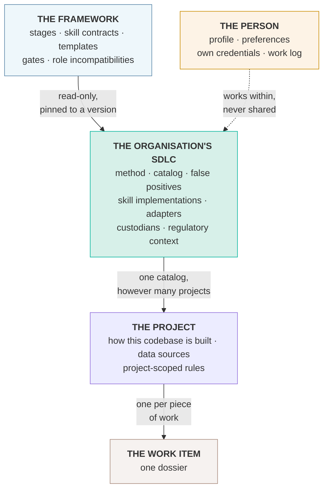
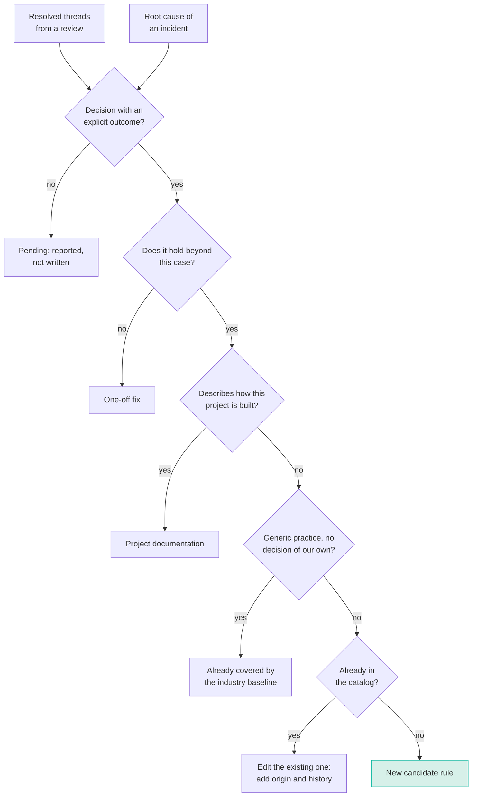
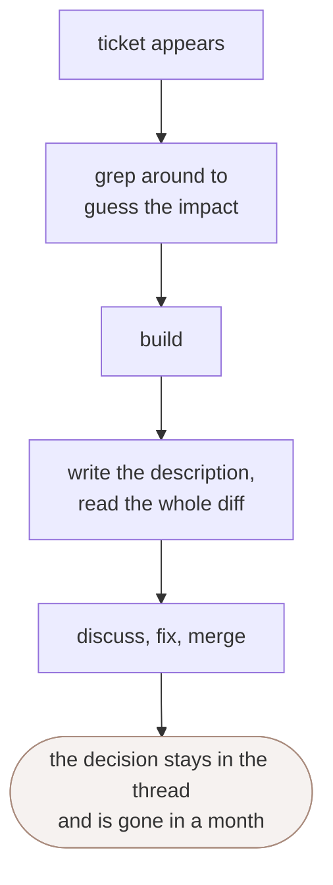
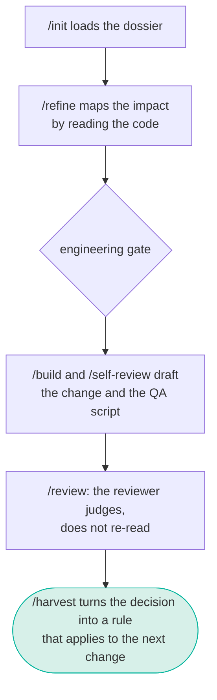

# GATE

### Governed, Assisted, Traceable Engineering

**An AI-assisted SDLC framework.** A software development life cycle that defines the stages,
their inputs and outputs, the human control points and the actors of each one.

Technical reference document, agnostic of company, domain, language, platform and AI assistant.

It is the foundation an orchestrator uses to build their own organisation's SDLC, with the AI
assistant the organisation chooses. It covers the whole journey: from building that SDLC, to
someone raising a need, to the system running in production, with the organisation having
learned something from doing it.

Assistance that stops where judgement begins.

[TOC]

---

## 1. The thesis

Most teams already use AI assistants. Almost always the same way: each person with their own
prompt, in their own window, leaving no trace. The result shows within a few months.

Quality depends on who used the assistant that day and how well they asked. Decisions
evaporate, and the same debate comes back three weeks later in another change. Security and
compliance arrive once the code is written, which is the most expensive moment. And nothing is
auditable: there is no way to answer which standard was applied to a change, who approved it,
or since when it has been in force.

GATE adds no new capability to the assistant. It orders the ones it already has into stages
with an input, an output and an owner, with explicit points where a person decides, and with
mechanisms that turn every decision and every incident into a reusable standard.

The gain does not come from the assistant doing more. It comes from what it does sticking,
chaining into the next step, and not depending on someone remembering.

### A foundation for building your own SDLC

GATE is not the SDLC an organisation runs. It is what an organisation builds its own SDLC
from.

The framework defines the stages, the skill contracts, the gates and the line between the
machine and the people, and it is the same for everybody. Each organisation's SDLC is a project
of its own: a repository holding its method, its standards catalog, the context of its
products, its skill implementations, its governance and the way each person gets in. GATE
explains; the organisation's SDLC applies.

That project has an owner from the first day, the **orchestrator**, and it can be built with
whichever AI assistant the organisation chooses. Section 2 says how.

### What kind of framework this is, and what it does not replace

GATE is an **SDLC**: it describes the life cycle of a software product, from the need to
retirement, with the stages, artefacts and controls of each leg. It sits in the same family as
the classic life cycle models and as continuous integration and delivery practice.

What sets it apart is that **AI assistance is in the design of the cycle, not layered on top of
it**. In existing models the assistant is added as a tool each person uses at their own
discretion. Here every stage declares what the machine produces, what the person decides, and
what gets written down for the next stage.

**It does not replace how you organise the team.** Scrum, Kanban or whatever you use to
prioritise, plan and coordinate keeps working on top of GATE. This framework defines no
ceremonies, no cadence, no estimation, and no backlog shaping. It defines the journey of a
piece of work and who clears each step.

**It does not replace your engineering practices either.** Continuous integration, automated
testing, infrastructure as code and progressive delivery are inputs to stages 5 through 9, not
alternatives to them.

---

## 2. Before stage 0: the orchestrator builds the SDLC

Every other section of this document assumes an SDLC that already exists. This one is about
how it comes to exist, and it is where any organisation starts.



### The orchestrator

The first role, named before anything else is built. The orchestrator builds the
organisation's SDLC together with the assistant, chooses which assistant the organisation
uses, assigns roles and profiles, and decides when the SDLC is ready to run.

The profile is short: authority in the organisation to assign roles, and enough technical
judgement to reject a well-written proposal from the assistant. In a small company it is
usually whoever leads engineering; in a consultancy, whoever leads the engagement. They do not
need to know every tool in advance. They need to answer questions about the organisation, and
decide.

### The assistant is the orchestrator's choice

GATE does not depend on a particular AI assistant. Any assistant that meets these conditions
can carry an SDLC built on it:

| Capability | What the SDLC uses it for | If the assistant lacks it |
|---|---|---|
| **Persistent instructions** loaded in every session | The rules that always apply and the map of the repository | Not viable: without it every session starts from zero |
| **On-demand skills** | One per skill contract in section 6 | Instruction files per task, invoked by name. Worse, still viable |
| **Repository and shell access** | Reading the code, running checks and tests | Not viable for the building roles. Product can still work through a chat client with connectors |
| **Hooks** before an action and at session start | Enforcing permissions, loading context, keeping the log | The platform carries the load: read-only credentials for the assistant, protected branches, and writes through a script that asks. Weaker, and the SDLC must say so |
| **Connectors** to the tracker and the observability platform | Reading tickets and production data | Small API clients in the SDLC repository, reading each person's own credential |

The SDLC is written once, in neutral formats, and a thin adapter wires it to the assistant
that was chosen:

- **Instructions** live in `AGENTS.md`, the convention most assistants read. Where an assistant
  expects another file name, the adapter is a one-line file that points to it.
- **Skills** follow the open `SKILL.md` format: a folder per skill, a name, a description that
  says when to use it, and plain instructions.
- **Guards** are plain scripts that read the intended action as JSON on standard input and
  answer allow, ask or deny. Most assistants with hooks already run scripts that way; the
  adapter only registers them on the right events.
- **Connectors** use the Model Context Protocol where the assistant supports it, and the
  repository's API clients where it does not.

An organisation can run more than one assistant over the same SDLC. Each one gets its adapter,
while the method, the catalog and the products stay single.

The choice is recorded in the SDLC's configuration and in its governance, with the version it
was verified against. Changing assistant later is a decision like any other: the orchestrator
takes it, the adapter is rebuilt and the final verification runs again.

### How the SDLC gets built

`/establish` is the first skill and the only one that runs before stage 0. The same line holds
as everywhere else: the assistant prepares, the orchestrator decides.

1. **The interview.** Before writing a single file the assistant asks, a few questions at a
   time: the organisation and what it builds, the assistant it will run on, who holds each
   role, which tool plays each part (code repository, tracker, production source of truth,
   pipeline), the products the pilot starts with, the technical layers worth a rule scope, the
   test environments, the profiles enabled per person, what should work first and by when, and
   what the organisation has already decided not to do. Every question has a default; what
   nobody knows is marked "to be defined" and never invented. It closes with a summary the
   orchestrator confirms.
2. **The layers, in order.** Skeleton, governance and plan, method, empty catalog, products,
   persistent instructions, guards and scripts, entry skills, cycle skills, adapter. Each layer
   is shown before the next starts, and nothing reaches a shared system without the
   orchestrator's approval.
3. **The verification.** A fixed checklist run at the end. Each point is reported as passed or
   failed, and every failure says what is missing and who it depends on.

[BUILDING.md](BUILDING.md) is the complete guide `/establish` follows: the decisions the
orchestrator takes and their defaults, the assistant adapters, the interview, the repository
structure, what every base file holds, the guards, the order, the checklist and the questions
that always come up. It is written so that an orchestrator can build the SDLC by reading it,
and so that any capable assistant can build it by following it.

### What the organisation's SDLC holds

| Part | What it answers |
|---|---|
| Persistent instructions | The rules that always apply, and where everything is |
| Plan | What is being built now, what comes next, what is out of scope |
| Governance | The roles, who approves what, who holds each role today |
| Method | The cycle as this organisation runs it: profiles, permissions, the person's log, session start, templates |
| Catalog | The rules by scope, each scope with its false-positive record |
| Products | The context of each product, its business rules, its use cases and their automated flows |
| Tools | Installer, access checker, guards, API clients and step-by-step access guides |
| Skills | The implementations of the contracts in section 6, plus the entry skills |
| Adapters | What wires all of the above to the chosen assistant |
| Personal | Each person's profile, preferences and log, ignored by version control |

### The formulation phase

While the SDLC is being built, the three incompatibilities in section 7 cannot hold: one
person proposes, approves and merges. GATE accepts that on two conditions. The phase is
declared in governance, and its exit is written before it starts.

The exit is observable and has a review date. A reasonable default: a person other than the
orchestrator installed the SDLC on their own and has their access verified; a product owner
used it on a real requirement; a builder took one of those without product questions; and a
rule harvested from real work entered the catalog. If none of that has happened by the review
date, the approach is reviewed before anything else is built.

From the day formulation ends, the orchestrator is bound by the same incompatibilities as
everyone else, and each custodian starts approving their own scope.

### Each person's way in

`/onboard` is the second skill outside the cycle, and every person runs it once: requirements,
installation, profile, access and a short live demonstration on their own data. It offers only
the profiles enabled for that person's verified identity, sets up each access one at a time
with the least privilege that works, and never asks for or accepts a credential in the chat.

A person who does not work in the repository, product most often, gets in through a chat client
with connectors and a read-only access of their own. The SDLC adapts the entry to the role.

### How the SDLC stays tied to GATE

The organisation's SDLC declares the version of GATE it implements, pinned to a commit, and
keeps a short map of which stage or principle each of its parts implements and where it
departs from the framework.

The departures are the useful part, because each one is either a local decision or a lesson
GATE has not learned yet. Lessons travel up the way a rule travels from a project to the
organisation: proposed as a candidate, with the origin told as a pattern and nothing that
belongs to the organisation. GATE never links to an organisation's SDLC, which is private by
nature. See [CONTRIBUTING.md](CONTRIBUTING.md).

---

## 3. Stage 0: the single entry point

GATE has **one door**. A person raises a need, a request or a new project, and everything
else chains from there.



What the person hands over at stage 0 can be as informal as a transcribed voice note or a
forwarded email. What **cannot** be missing is who is asking and what for. The first stage
gathers everything else by asking.

Each of those three chains is walked step by step in [START-HERE.md](START-HERE.md), with what
it changes compared with working without the framework, and what it costs.

### The dossier

Stage 0 produces a **dossier**: a single artefact that travels with the work through the whole
cycle, accumulating what each stage produces. It is what lets the stages chain without anyone
retyping the context.

| Stage that writes it | What it adds to the dossier |
|---|---|
| 0 · Entry | Who is asking, what for, and what type of work it is |
| 1 · Definition | Problem, context, constraints, data classification |
| 2 · Requirements | Functional and non-functional acceptance criteria, compliance requirements |
| 3 · Refinement | Affected components, risks with owners, test and observability plans |
| 4 · Design | Architecture decision, alternatives ruled out and why |
| 5 · Development | Proposed changes, instrumentation, tests |
| 6 · Pre-review | Findings resolved, functional verification script |
| 7 · Change review | Threads, decisions, published findings |
| 8 · Verification | Result per criterion |
| 9 · Deployment | Post-deployment check against the stage 2 criteria |
| 10 · Operations | Incidents, root causes, recovery drill results |
| 11 · Validation | Outcome measured against the stage 1 problem |
| 12 · Learning | Rules harvested, discards with their reason, pending decisions |



Nothing on that line is rewritten. Each stage adds and none re-asks. That is the point: context
stops being rebuilt at every handover.

The dossier is also the audit record. It answers what was asked for, which standard was
applied, who approved each step, and on what evidence.

### What chains on its own and what does not

The chain advances by itself between stages. **It stops at every human gate**, without
exception.

A cycle that runs end to end without intervention is not this framework: it is a code factory
with no owner. The gates are the product, not the obstacle.

---

## 4. Principles

They apply to every stage. An implementation that breaks one stops being GATE.

**The assistant prepares, the person decides.** The assistant does the heavy lifting: reading,
correlating, drafting, checking. Every consequential decision belongs to a person, and is taken
on something already written down.

**Nothing runs unattended into shared systems, and the person decides how far to delegate.**
Publishing a comment, opening a change, writing in a ticket, touching an environment, silencing
an alert. By default all of it is shown first and executed on explicit approval. After the
first approval in a scope, such as one repository or one tracker project, the person may
authorise that scope for the rest of the session. The assistant can never authorise itself,
and the authorisation ends with the session. A short list is never delegated, whatever was
authorised: production, merges, deletions, rewriting history, and anything to do with
credentials.

**What must hold is enforced by the environment, not by the prompt.** An instruction fades
over a long session, the same way a person forgets to run a command. Permissions, session start
and the person's log live in guards the environment executes, and a guard that fails asks
instead of letting the action through. The hard controls stay on the platform: protected
branches, mandatory approvals, the pipeline. A skill guides; it does not enforce.

**Verify before asserting.** No claim about how the system works rests on the assistant's
memory or on documentation that may be stale. It is checked against the code, the data or the
environment, and against what is actually deployed rather than whatever copy happens to be
checked out. If it could not be checked, that gets said.

**Roles, not names.** Every document names the role. Names live in a single table, and a
person is identified by their verified account, never by what they type. When someone rotates,
one row changes and nothing else.

**Nobody does another person's part.** What depends on someone else is asked of them, in the
ticket where it lives, and the work carries on with what is one's own. Doing it for them hides
the dependency, and the next time it fails the same way.

**Write for whoever decides.** An artefact meant for a person is short, plain, and carries
nothing the reader does not already know. Text that reads like machine output loses its reader
before it reaches the point.

**One session, one workspace.** Several assistant sessions may work on the same repository at
once. Each works on its own isolated copy, and re-reads the shared state before claiming that
something does not exist.

**Every rule shows where it came from.** A standard with no link to the discussion or incident
that produced it is someone's opinion in the shape of a norm.

**Discards get recorded.** When someone rejects a finding, the reason is written down. Without
that the assistant raises it again and the team learns to ignore it, including the findings
that mattered.

**Missing dependencies get named.** If an access, a token or a data source is missing, say
which one and carry on with what you can, marking what was left uncovered.

**Check before creating.** Before opening a ticket, a change or a comment, check whether it
already exists. If it does, update it. Never a duplicate.

**Every stage delivers a verifiable artefact.** A stage whose output is "we agreed" did not
happen.

**The dossier is the only source of context.** What is not in the dossier does not exist for
the next stage. That forces the context to be written down instead of living in the head of
whoever was in the meeting. The ticket stays the place where other people look: it links to
the dossier, and anything that changes a task is written in that task's ticket.

---

## 5. The cycle



The dotted arrows are the learning loop. A decision taken today in a review, or a root cause
found today in an incident, becomes a standard that tomorrow applies on its own, before any
code is written.

That the catalog also feeds refinement is what stops the standard from being merely corrective.
A requirement that collides with a rule in force is caught before the first line.

---

## 6. The skills, named

Two foundation skills, fourteen cycle skills and two cross-cutting ones. The names are GATE's
proposal; what is not negotiable is each one's contract: who triggers it, what it takes in,
what it delivers, and where it stops to ask.

Each contract is independent of the assistant. Implementing it is the organisation's part, in
the open `SKILL.md` format, with the assistant the orchestrator chose.




Thick arrows come out of a person: those are the **five moments of human invocation**. Thin
ones are chained by the framework. Dotted ones feed learning. Diamonds stop the chain until
someone decides.

### Each skill's contract

| Skill | Stage | Triggered by | Delivers | Writes outside, on approval |
|---|---|---|---|---|
| `/establish` | Foundation | **Orchestrator** | The organisation's SDLC, built and verified on the chosen assistant | The SDLC repository |
| `/onboard` | Foundation | **Person**, or `/establish` for the first one | A person ready to work: profile, access verified, a first demonstration | Nothing shared |
| `/init` | 0 | **Person** | Dossier opened and classified by type of work | Ticket |
| `/define` | 1 | `/init` | Problem, context, data classification | Ticket |
| `/specify` | 2 | `/define` | Acceptance and compliance criteria | Ticket |
| `/refine` | 3 | `/specify` | Components, risks with owners, test and observability plans | Subtasks |
| `/design` | 4 | `/refine` | Contrasted alternatives and a recorded decision | Decision record |
| `/build` | 5 | **Person** | The change, implemented, instrumented and tested | Repositories |
| `/self-review` | 6 | `/build` | Private findings, affected flows run, change proposal, QA script | Change and script |
| `/review` | 7 | **Person**, several times | Thread answers and its own findings | Comments, one by one |
| `/verify` | 8 | **Person**, with the `/self-review` script | Automated flows run and a result per criterion | Nothing |
| `/deploy` | 9 | **Person** | Full regression before release, post-deployment check against the criteria | Production |
| `/operate` | 10 | Alert or person | Diagnosis grounded in sources | Alerts and incidents |
| `/postmortem` | 10 | Incident closure | Timeline and root cause | Document |
| `/validate-outcome` | 11 | `/deploy`, after the stage 2 window | Outcome against the original problem | Ticket |
| `/harvest` | 12 | `/review` and `/postmortem` | Candidate rules and three lists | Catalog, rule by rule |

Every skill declares explicitly **what it does not do**. An assistant with no written limits
invents them on the fly, and invents them differently every time.

### The five moments of human invocation

People start the chain at five points, and only five: when the need is born (`/init`), when
someone sits down to build (`/build`), when someone reviews (`/review`), when someone tests
(`/verify`) and when someone deploys (`/deploy`). The framework chains everything else.

Before the cycle there are two more, each run once: when an organisation builds its SDLC
(`/establish`) and when a person joins it (`/onboard`).

That matters because **mechanisms that depend on a person remembering to invoke them do not
happen**. The classic symptom is an empty standards catalog next to changes carrying hundreds
of discussion comments: nobody remembered to harvest.

### Cross-cutting skills

Two capabilities belong to no single stage and several stages consult them:

| Skill | What for | Consulted by |
|---|---|---|
| `/catalog` | Fetch the rules in force that apply by scope and project | `/refine`, `/design`, `/self-review`, `/review` |
| `/false-positive` | Record a finding the team rejected, and the reason | `/self-review`, `/review` |

---

## 7. The actors

### The line between the AI and the people

The whole framework rests on a split that admits no exceptions.

**The AI produces and verifies. The person judges and authorises.**

Four things the AI always does, at every stage:

1. Read and correlate whatever is needed, without tiring or skipping parts.
2. Draft every artefact, so nobody starts from a blank page.
3. Check against the source rather than against its memory, and say when it could not check.
4. Chain the next stage carrying the dossier, so context is never retyped.

Four things a person always does, and the AI never:

1. **Accept or reject at a gate.**
2. **Choose between alternatives when something has to be given up.** A trade-off between cost,
   time and scope is a business decision, not a calculation.
3. **Authorise any write into a shared system.**
4. **Answer for the outcome.** Responsibility is not delegated to a tool, and an organisation
   that tries finds out at the first audit.

When one of the four on the right moves to the left, the framework stops applying, however
unchanged everything else looks.



The loop between those two boxes is the framework. The machine never crosses into the second
one, and a person never has to do the first one by hand.

### The nine roles

Roles, not job titles. One person can hold several.

| Role | What they clear | Profile |
|---|---|---|
| **Orchestrator** | Section 2: builds the SDLC, chooses the assistant, assigns roles and profiles, and decides when formulation ends | Authority to assign roles and judgement to reject the assistant's proposal. Bound by the incompatibilities once formulation ends |
| **Requester** | Nothing. They raise the need | Knows the problem first hand. Needs no technical profile |
| **Product owner** | Gates 1, 2 and 11 | Decides what gets built and what does not. Can take being told their hypothesis failed |
| **Engineering lead** | Gates 3 and 4 | Architecture judgement and memory of the system. Able to reject a well-written proposal |
| **Builder** | Gate 6, over their own work | Implements. Can read what the AI proposes and spot when it is wrong |
| **Reviewer** | Gate 7 | Someone other than the builder. Exercises judgement rather than re-reading what the AI said |
| **Verifier** | Gate 8 | Tests against the criteria. Can be another builder on the team |
| **Operations owner** | Gate 9 and any action on production | Keeps the service up. Decides on rollback |
| **Standard custodian** | Gate 12 | Approves rules. For hard rules, the whole team |

### The three incompatibilities

One name can hold several roles, except in three cases. These are what keep judgement
independent when the team is small.

**Whoever builds does not review that same change.** This is the separation that stops the
assistant from ending up as the only reviewer.

**Whoever proposes a design decision does not accept it.** A single alternative presented
without contrast, approved by the person who wrote it, is a decision nobody took.

**Whoever builds does not validate the business outcome.** Nobody judges their own work well.

### Who takes part in each stage

| Stage | The AI does | The person does | Who |
|---|---|---|---|
| 0 · Entry | Classifies the work, opens the dossier | Raises the need | Requester |
| 1 · Definition | Drafts the problem, flags ambiguity, classifies data | Accepts the statement | Product |
| 2 · Requirements | Proposes criteria, demands numbers on the non-functional ones | Accepts the criteria | Product and engineering |
| 3 · Refinement | Maps components by reading the code, raises risks | Assigns an owner to each risk, accepts the breakdown | Engineering |
| 4 · Design | Puts forward contrasted alternatives and their consequences | Picks one and answers for it | Engineering, not the builder |
| 5 · Development | Implements, instruments, writes tests | Directs and corrects | Builder |
| 6 · Pre-review | Reviews in private, drafts the proposal and QA script | Approves each publication | Builder |
| 7 · Change review | Answers threads, raises findings, harvests | Confirms each finding before it is published | Reviewer |
| 8 · Verification | Runs the automated flows, drafts the script for the rest | Runs the script, reads the results and signs each criterion | Verifier |
| 9 · Deployment | Compares against criteria, proposes rollback | Authorises every action on production | Operations |
| 10 · Operations | Diagnoses with evidence, drafts the postmortem | Decides what gets touched and what gets alerted | Operations |
| 11 · Validation | Measures the outcome against the original problem | Decides to close, iterate or roll back | Product |
| 12 · Learning | Drafts the candidate rule with its origin | Confirms it is a team decision | Custodian |

### How many people

Thirteen stages and nine roles do not mean thirteen people. Roles concentrate, and the three
incompatibilities are what set the floor.

**Viable minimum: three people.** One in product, and two engineers who alternate: when one
builds, the other reviews, and the other way round. That satisfies all three
incompatibilities. Either engineer can carry operations.

**Recommended: four or five.** Add someone dedicated to operations, the role that survives
part-time worst because incidents do not wait. And separate the requester from product, so the
person asking is not the person approving.

**Practical ceiling: seven.** Above that the gates start queuing and the cycle stalls waiting
for approvals. When a product needs more people, split it into two cycles with separate
dossiers rather than fattening one.

A traditional cycle covering the same ground usually spreads these roles across eight or ten
people, with a context handover at every step. The reduction does not come from anyone
working more: it comes from context travelling in the dossier instead of being rebuilt in
every handover meeting.

### A warning about small teams

Fewer people means fewer independent viewpoints. A small team with strong assistance converges
fast, and can converge with great confidence on the wrong answer, because the assistant writes
the wrong thing as fluently as the right one.

The three incompatibilities exist for exactly that. A team that cuts headcount and also relaxes
them is not applying GATE: it is automating its own bias, faster than before.

---

## 8. Scopes: one framework, many contexts

An organisation rarely has one product. It has products, services, internal tools and the odd
isolated system that shares nothing with the rest. And a consultancy has several organisations
at once.

GATE is the same door for all of them. What changes is not the cycle: it is **where each thing
lives**.

### The five levels



| Level | What lives there | How many |
|---|---|---|
| Framework | The method: stages, contracts, templates, gates | One, for everybody |
| Organisation | Its SDLC repository: method, catalog, false positives, product context, skill implementations, assistant adapters, custodians | One per organisation |
| Project | How that codebase is built, its data sources, its own rules | One per product or service |
| Work item | The dossier | One per piece of work |
| Person | Profile, preferences, personal credentials and the log of their own work | One per person, on their own machine |

The person's level is what lets someone pick a topic up again a week later without rebuilding
it. The assistant keeps the log on its own, a short summary per topic with what was decided,
what is pending and where everything is, and reads it before resuming. It lives on the person's
machine, is ignored by version control, and points to the tickets rather than copying them.

**One catalog per organisation, not one per project.** This is the decision that matters most.
With a catalog per project, a rule learned in one never reaches another, and the compounding
that pays for the whole framework disappears. You would have twenty silos learning the same
lesson twenty times.

Scoping is what keeps that from becoming noise: a rule carries `projects`, so it applies where
it belongs and stays out of stacks it has nothing to say about.

### How a project declares where it belongs

GATE does not create the organisation. The organisation already exists: it has a name, an
identity provider, a git group and someone accountable for compliance. Inventing a parallel
notion of it would duplicate something real and the two would drift apart.

What the framework does require is that **every project declares which one it belongs to**, in
a `.gate/config.yml` at its root. Three of its fields settle the relationship: which catalog it
reads, who approves its hard rules, and what regulatory context applies.

From that, the organisation follows by construction: **two projects reading the same catalog
are the same organisation**. Nothing else defines it, and nothing else needs to. The standards
repository is already the only thing they share, so it is what identifies them.

The config is also where the cycle finds everything else it needs: the repositories a piece of
work may touch, the branch convention, the lint and test commands, the data sources, the
rollback procedure and who clears each gate. `/init` reads it before anything, fills in what it
can detect from the repository, and stops until the fields required to start are filled.

It does not have to be complete to begin. Each field is tagged with the stage that needs it,
and leaving one empty is a valid declaration that the stage using it is not in use yet. Eight
fields are enough to start; the rest arrive with the stages.

```
python3 bin/check_config.py .gate/config.yml
```

Reports what is filled, what blocks the start, and which stage is waiting on each gap.

### When a registry becomes worth it

Not before the second project, and not before somebody actually needs a cross-project answer.

The moment it earns its place is when the question from the end of this section appears: which
projects satisfy rule HR-0007. Answering that needs a list of the projects pointing at a
catalog, and that list is a registry.

Built earlier, it is a list nobody reads that drifts from reality. The declaration comes first;
the registry is a consequence of a reporting need, never the starting point.

### Isolated contexts

A service that shares nothing with the rest still enters through `/init` and runs the same
thirteen stages. It is simply a project whose rules never leave project scope.

That is not a lesser case. Being able to run the cycle on something isolated, with no catalog
worth speaking of and no other project to learn from, is what makes GATE usable on day one, by
one team, before any of this topology exists.

### What travels, and what never does

**Only a rule travels upward.** Everything else stays where it was created.

A rule is born scoped to the project where it was harvested. It reaches organisation scope when
there is evidence it applied in a second project, and that promotion is a human decision
recorded in the catalog like any other.

Four things **never** cross an organisation boundary, and this is not a preference:

- **Dossiers.** They carry the client's problem, their data classification and their incidents.
- **Data sources.** Logs, metrics and audit trails belong to whoever owns the system.
- **Credentials.** Personal, per person, per organisation.
- **The project definition.** It describes a codebase that belongs to someone.

The person's level does not travel at all: it never leaves that person's machine.

For a consultancy this is the line that keeps one client's material out of another's. It is
worth stating in the contract, not just in a document.

### Between organisations

The framework is shared: it is public and identical for everyone. The catalogs are not.

A rule does not cross from one organisation's catalog to another automatically, ever. Risk
appetite, regulation and legal exposure differ, and a hard rule that is right for one can be
wrong or simply inapplicable for the next.

What does travel is a person carrying a lesson. The mechanism is to **propose** it in the other
organisation's catalog as a candidate, with the origin pointing at where it was learned. It
then goes through that organisation's own approval like any other candidate.

### Governance once there are many projects

Three things change, and none of them is technical.

**The custodian stops being a person.** With one project, whoever knows the codebase can hold
the standard. With twenty it needs a small group, and a rule for what happens when they
disagree.

**"The whole team approves hard rules" needs a definition.** The framework says a hard rule
requires the team's approval. Once there is no single team, you have to say which one: the
affected projects' leads, a standards group, or whoever your organisation already trusts with
cross-cutting decisions.

**Compliance becomes a question you have to be able to answer.** Which projects satisfy rule
HR-0007. With one project you know from memory. With twenty you need to report it, and the
framework does not provide that today: the catalog says what the rule is and the dossier says
what was applied to one change, but nothing aggregates the two across projects.

That gap is real and it is named here rather than glossed over. The cheapest honest answer for
now is that each project's pre-review already reads the catalog, so non-compliance surfaces on
the next change to that project rather than on a report.

---

## 9. The stages

### Stage 1 · Definition

Turns a need in business language into a statement an engineering team can assess. Product runs
it.

The assistant drafts the statement separating the observed problem from the solution someone
already imagined: most requests arrive with a solution inside and without the problem that
motivated it. It flags ambiguity instead of resolving it, returning both possible readings. It
classifies the data involved — personal, health, financial, regulated — and that classification
travels with the dossier to production, setting the depth of every later stage. And it looks
for precedent: earlier tickets, decisions already taken, related incidents, catalog rules that
apply.

**Gate.** Product accepts. Nothing moves on without a data classification.

### Stage 2 · Requirements

Settles what done means, in terms that can be checked.

The assistant proposes acceptance criteria that can be verified, and demands numbers on the
non-functional ones: response time, expected volume, required availability, tolerable recovery
window. Without a number they cannot be verified in stage 8 or watched in stage 10. It derives
the compliance requirements that follow from the data classification: retention, audit,
encryption, minimisation, data subject rights. And it points out which criteria will need
instrumentation, so stage 3 accounts for it.

It also proposes the **use cases** the requirement adds or changes: what the product's users do
every day and must not break, written in business language. Product validates each one, and
the validated cases go into the product's catalog of use cases. They are the bridge to stage 8,
where each one becomes an automated flow. A requirement that changes no journey says so, with
its reason.

**Gate.** A non-functional criterion without a number goes back. A use case product has not
validated does not become a test.

### Stage 3 · Refinement

Turns requirements into executable work, with the risks on the table before any code.

The assistant breaks the work into tasks with verifiable outputs, and maps the affected
components **by reading the actual code**: a map drawn from memory or from an old diagram is
wrong precisely about the systems that changed the most. It raises security and compliance
risks grounded in the data classification and the hard rules in force. It detects when a
requirement collides with a rule in force and raises it as a product decision. It proposes the
test plan and the **observability plan**: whatever is not instrumented here does not exist in
stage 10.

**Gate.** A risk without an owner blocks the move to development.

### Stage 4 · Design

Settles the architecture decision before any code, and puts it on the record.

This is where assistance pays off most and carries most risk: the assistant proposes a solution
as fluently whether it is well founded or not. That is why the decision is recorded, not just
the result.

It puts forward **at least two workable alternatives** with their consequences, rather than
presenting one as if it were the only option. It names what each alternative closes off for the
future, which usually weighs more than its cost today. It checks each one against the rules in
force and against the patterns the project already holds. And it writes a short decision
record: what was decided, what was ruled out and why, and what would have to change to revisit
it.

**Gate.** Someone who did not draft the proposal accepts the decision. A single alternative
presented without contrast goes back.

This record is one of the best sources for stage 12: a design decision already arrives argued
and contrasted, which is exactly what a rule usually lacks.

### Stage 5 · Development

Implement, leaving the trail the later stages need. The assistant consults the catalog before
proposing a pattern, instruments what the plan called for in the same change rather than
afterwards, and writes the tests alongside the code.

### Stage 6 · Pre-review

First of the two reviews. It is **private**: its output goes to the author. It exists so the
change reaches human review already cleaned up.

It identifies the ticket from the branch and pulls its definition without editing it. It
determines every repository the change touches and checks none was left half done. It runs
linters and static analysis. It checks every claim about conventions against the actual code.
It runs a full hard-rule pass if the change touches authentication, authorisation, tenant
isolation or sensitive data. It cross-checks the artefacts that travel together: migrations
with their changelog entry, instrumentation with the plan, documentation with the code. It
compares **the whole branch against the base**, not just the latest commits, against the
criteria from stage 2. It runs the automated flows of the use cases the change touches, and
checks that the cases the ticket added are in the product's catalog and automated. And it
drafts the change proposal and the functional verification script.

It reviews **what the change introduced**, not the system it lands on. Whatever was already
there is not a finding of this change, neither as a finding nor as a pending item.

**Gate.** The author approves every output into a shared system.

### Stage 7 · Change review

Someone other than the author validates the change, with support. **It runs several times**
while the review lasts: a single pass when the change opens arrives before the decisions exist.

It reads the threads across every change in the ticket and splits them into open ones, which
need answering, and **resolved** ones, which are the input for stage 12. It checks every
suggestion from another reviewer against the actual code before backing it or pushing back. It
raises findings with severity, file and line, and with the rule id when the finding comes from
the catalog: without that id nobody can go and argue with the rule, and arguing with it is how
the standard improves. It consults the false-positive record before raising something already
rejected. It checks that the change is up to date with its target branch and raises conflicts
or drift as a request to rebase.

A push clears the reviewer's approval. The branch is updated first and the review is asked for
afterwards, and nothing merges without an approval that is still in force.

**Gate.** Every finding is presented with an explicit counterfactual question — whether it
really applies here or is a false positive — and is published only on confirmation.

> **Why two reviews and not one.** The pre-review is private and exists so the author can fix
> things at no social cost. The change review is public and exists so another person exercises
> judgement. Merging them turns the assistant into the reviewer, which is exactly what this
> framework avoids.

### Stage 8 · Functional verification

Check against the criteria from stage 2, on the running system. There are two kinds of check
and one rule for both: the assistant may run them, but it never signs them off.

**Automated flows.** Each validated use case from stage 2 is a test that walks the application
from the outside, the way a person would, against a deployed test environment. The assistant
runs them on the machine of whoever is verifying, with that person's own configuration, which
never travels and never sits in a shared pipeline. Five rules keep them honest:

- Never against production. A list of allowed hosts stops the run before anything opens.
- Nothing with a real cost or effect, such as charging, buying, signing or writing to a third
  party, leaves a test unless the environment simulates it and that run authorises it.
- The case comes from what product defined, not from what the code does today. A test written
  by reading the code freezes its bugs as expected behaviour.
- Few flows, the critical ones. A false red is fixed or switched off the same day, because one
  flaky test teaches the team to stop looking at all of them.
- A test that never ran is not delivered as done. Every run leaves local evidence of who ran
  it, against what, and with what result.

**The manual script.** For whatever cannot be automated, the assistant drafts a script for a
person to run. A good script does six things: one checkbox per **verifiable result** rather than per case, so
a failure points at what failed; one block per affected component, naming what to look at on
each screen; the precondition written as a check the tester can perform, with what to do if it
is not met; steps executable with the tools they already have; known false alarms stated up
front; and what to do with whatever cannot be tested in that environment, which is to leave it
unchecked and note it, never mark it failed.

**Gate.** A stage 2 criterion left unverified blocks deployment. The verifier signs each
criterion, whoever ran the check.

### Stage 9 · Deployment and post-deployment check

Put the change in production and check with data that it behaves the way the criteria said.

The assistant gathers the manual steps the deployment requires instead of letting them surface
during the window. It compares observed behaviour against the non-functional criteria from
stage 2 using the data sources from stage 10: that comparison is why those criteria had to
carry a number. It watches the window afterwards for deviations from the previous baseline,
not from an invented threshold. On detecting a deviation it presents the evidence and
**proposes** a rollback; the decision is human.

**Preconditions.** A rollback procedure that has been exercised, not merely documented. And
before each release, every automated flow of the product runs; a regression blocks the release.

### Stage 10 · Operations, SRE and continuity

Keep the service up, detect before the user does, and recover inside the committed window.

#### The data sources

An assistant with no access to operational data offers opinions. With access, it diagnoses.

| Source | What it answers | Common mistake |
|---|---|---|
| Application logs | What the system did and with what error | Taking an intermediary's log as if it were the origin's |
| Metrics | How much and how fast, over time | Watching averages and losing the high percentiles, where the problem lives |
| Distributed traces | Where a request went and where the time went | Not propagating the correlation id and losing the chain |
| Infrastructure logs | What the platform did underneath the service | Blaming the application for node rotation or network |
| Audit trail | Who did what, when, over which data | Mixing it with application logs and losing its evidential value |
| External dependency status | Whether the problem is ours or inherited | Diagnosing inward a failure that belonged to a third party |

Three conditions make them useful. A **correlation id propagated end to end**, without which
each source tells a different story. **One source of truth per question**: when two dashboards
answer the same question with different numbers, the team stops believing both. And **declared,
sufficient retention**, which follows from the compliance requirements of stage 2, because an
incident investigated three days later needs data from three days ago.

#### What the assistance does

It correlates the sources from a symptom and separates cause from noise, grounding every claim
in the source that can prove it. It compares current behaviour against the baseline before the
last change and links it to the ticket that introduced it. It proposes what deserves an alert
and, above all, what does not: if nobody will do anything differently when it fires, it is a
dashboard number. It drafts the postmortem with the timeline rebuilt from the sources, not
from the memory of whoever was on call. And it prepares the recovery drill script, comparing
the real result against the committed window.

#### Securing operations

Five conditions. None is exotic and almost none is met in full.

**A rollback that has been exercised.** A procedure never run is a hypothesis.

**Recovery windows with a number and a drill.** How long you tolerate being down and how much
data you tolerate losing, declared in stage 2 and measured in a real drill.

**External dependencies with defined degradation.** What the system does when a third party
does not answer. Without that definition, the default answer is to pass the failure to the
user.

**Blast radius isolation.** That one component failing does not drag the rest. Proven by
causing it in a controlled environment.

**Audited emergency access.** With a trail and an expiry. Permanent emergency access is normal
access under a misleading name.

### Stage 11 · Outcome validation

Go back and ask whether the problem from stage 1 was solved.

This is the stage almost no cycle has, and its absence is why organisations measure what they
shipped rather than what worked. Stages 8 and 9 check that the system does what the criteria
said. Neither checks that this solved anything.

It runs once the change has been in production long enough to have data, and that window is
set in stage 2 alongside the criteria.

The assistant compares observed behaviour in production against the problem stated in stage 1,
using the data sources from stage 10 and whatever business indicators apply. It distinguishes
three outcomes and names them without softening: the problem was solved, it was half solved and
here is what was left out, or it was not solved and the stage 1 hypothesis was wrong.

**Gate.** Product accepts the outcome and decides: close, iterate, or roll the feature back.

This is the framework's **second learning loop**. The stage 12 loop improves how things get
built; this one improves what gets decided. A product hypothesis that failed is as valuable as
a root cause, and is lost just as easily.

### Stage 12 · Learning

Make what was learned outlive the conversation or the shift where it appeared. **Two sources,
one destination.**




An incident is as good a source of rules as a discussion, and usually yields better ones:
nobody argues with a root cause that already cost an outage.

**Gate.** Every rule is presented with a counterfactual question — whether it is a team
decision or the assistant's general opinion with a link stapled to it.

**Output.** Candidate rules and a report with three lists, delivered every time even when the
first is empty: harvested, discarded with the reason, and pending decisions.

A rule is born **with no blocking power**. Acquiring it is an explicit human decision, and for
security rules, the whole team's. That stops the assistant from imposing standards nobody
agreed to.

### Optional stage · Retirement

Switching off a system or a feature carries obligations almost no cycle covers, and it is where
compliance risk piles up quietly.

What has to be settled: which data must be kept and for how long, which must be deleted and
with what evidence, which integrations depend on what is being switched off, and who owns the
historical archive afterwards. The data classification from stage 1 says what applies.

Adopt it when the organisation actually retires systems. One that never switches anything off
does not need the stage, and usually has the problem of never switching anything off.

---

## 10. Effect on the organisation

### Where the time goes today

In a traditional cycle with no or limited AI support, much of the effort is not spent deciding.
It is spent producing and carrying artefacts: drafting the ticket, explaining the context again
at refinement, reading the whole change to review it, writing the test script, rebuilding an
incident timeline by hand, and drafting the postmortem nobody will reread.

That work is necessary and it is mechanical. It is exactly where assistance pays.

**One change, the usual way**




**The same change, with GATE**




The mechanical steps on the first line — grepping for impact, writing the description, reading
the whole diff — are the ones that collapse. What does not collapse is the judgement: the gate
in the middle and the reviewer near the end.

And the last step on the second line has no equivalent on the first. That is where the
compounding comes from: the same discussion does not happen twice.

### What changes with GATE

Mechanical work collapses and **the bottleneck moves to judgement**. What used to take an
afternoon of drafting becomes a review of something already drafted. The gates stop being
paperwork and become the work.

That has three consequences worth stating plainly.

**The same team covers more ground.** Not because anyone works more, but because they stop
producing intermediate artefacts by hand.

**Roles consolidate.** The line between whoever refines and whoever builds, or between whoever
operates and whoever diagnoses, blurs once context travels in the dossier instead of in
someone's head. A smaller team can sustain a product that used to demand several separate
roles.

**The cost of a bad decision rises.** When the assistant produces in minutes what used to take
days, a wrong call propagates just as fast. That is why the gates are mandatory and why the two
reviews are kept apart.

### The warning

Cutting headcount is a possible consequence, not a goal of the framework, and it carries a
concrete risk: fewer people means fewer independent viewpoints.

A small team with strong assistance can converge quickly on the wrong answer, and converge
confidently, because the assistant writes the wrong thing as fluently as the right one.

The countermeasure is in the design: that pre-review and change review are never the same
person, that the product and engineering gates are held by someone who did not write what is
being approved, and that no rule reaches blocking status without the team's approval. A team
that cuts people and also relaxes those three points is not applying GATE: it is automating
its own bias.

---

## 11. What improves, and how to check it

Without indicators, this is a well-written opinion.

**Productivity.** Time between a change being ready and entering review. Time to diagnose an
incident.

**Quality.** The share of findings that surface in pre-review versus those that reach human
review. If the second number does not fall over time, the cycle is not learning.

**Security.** How many security findings are caught before any code is written.

**Compliance.** That for any change in production you can answer which standard was applied,
with which rule, at which version, approved by whom. A versioned catalog answers that; a
conversation with an assistant does not.

**Continuity.** Recovery drill results against the committed window. The share of incidents
detected by your own instrumentation before a user reports them.

**Learning.** How many rules entered the catalog per quarter, and how many repeated discussions
stopped happening. A catalog that does not grow means stage 12 is not running, whatever the
other eleven say.

**Judgement at the gates.** The share of drafts each gate rejects or corrects. A gate that
never rejects anything has become a ceremony, and the judgement the framework moved the
bottleneck to is no longer being exercised.

**The SDLC itself.** The formulation exit criteria from section 2, checked on their review
date. Until they are met, the organisation has a project in construction, not an SDLC in use.

---

## 12. Preconditions

- An orchestrator, named, and an AI assistant chosen by them that meets the conditions in
  section 2.
- Personal credentials per person, never shared, with the least privilege that works and an
  expiry, stored on the person's machine with restricted permissions. Never in a repository and
  never in a chat. A team token destroys the traceability of who approved what.
- An identity the SDLC can verify a person against: their account on the code platform or the
  tracker, not the name they type.
- For the roles that build and review, a local copy of every repository the cycle touches,
  including the organisation's SDLC. Roles that do not work in the repository get in through
  their own tools, with a read-only access of their own.
- A catalog readable by machine, versioned, with a format validator.
- A low-friction place to record false positives, outside the rule approval process. If
  recording a false positive cost an approval, nobody would record one.
- A branch convention that links to the ticket, so traceability resolves without asking.
- A correlation id propagated end to end, and a declared retention period.
- A place for the dossier to live, readable by people and by machine.

---

## 13. Adoption

In this order. Each step works without the ones after it, and none requires the previous one to
be perfect.

0. **The orchestrator builds the SDLC.** `/establish`, on the assistant the orchestrator chose,
   with the formulation phase declared and its exit written. See section 2 and
   [BUILDING.md](BUILDING.md).
1. **The standards catalog, empty.** With a rule format, a validator and a generated catalog.
   Empty on purpose: a set copied from an industry guide describes whoever copied it.
2. **Each person's way in.** `/onboard`, with the profiles enabled per person and access
   verified one at a time. Nothing else runs for someone whose access is not green.
3. **The pre-review.** It returns the most for what it costs and forces nobody else to change
   how they work.
4. **The change review, with harvesting inside it.** Both together. An assisted review that
   does not harvest leaves the cycle open.
5. **Functional verification.** The product's use cases, validated by product, automated as
   flows, plus the manual script for the rest. It draws a clear line between review and QA.
6. **Refinement and design.** Once the catalog holds rules worth consulting before settling an
   architecture.
7. **Operations and SRE.** Requires the data sources to exist and be trustworthy, usually the
   longest work of all.
8. **Stage 0, definition and requirements.** They depend on product picking up the habit, and
   that cannot be decreed.
9. **Outcome validation.** Last, because it needs trustworthy business data and the willingness
   to record that a hypothesis failed.

The framework pays from step 3. There is no need to wait for the whole thing.

The order is by phase as well as by step. The first phase is product and building: a product
owner who defines and hands over with quality, and a builder who takes it and builds with the
team's rules. Operations and security come second, and visibility for leadership third. A
phase opens when the previous one works with real people.

---

## 14. Anti-patterns

**The assistant that acts on its own.** Publishes, opens changes or touches environments
without approval. One visible mistake is enough for the team to lose trust and go back to doing
everything by hand.

**The chain with no gates.** A cycle that runs end to end without human intervention produces
code with no owner, and nobody can answer why it was done that way.

**The catalog filled in one sitting.** Fifty rules copied from a generic guide. Nobody
recognises them as their own and the team learns to ignore the findings.

**Manual harvesting.** A command someone should run when they remember. It does not happen.

**The single-pass review.** Decisions appear when threads get resolved, and by then nobody is
looking.

**The silent discard.** Rejecting a finding without recording the reason.

**The rule with no origin.** A norm nobody can trace gets re-argued every time it appears.

**Observability as a later task.** The first incident is diagnosed blind.

**The alert nobody acts on.** It trains the team to ignore the whole channel.

**The non-functional criterion with no number.** It cannot be verified in QA or watched in
production, so in practice nothing was required.

**The assistant opining on production without data.** A diagnosis with no sources is a
well-written guess, which is worse than none.

**The abandoned dossier.** If one stage stops writing to it, the next one asks again what was
already answered, and the chain breaks without anyone noticing.

**The formulation with no exit.** The orchestrator keeps approving everything for good, and the
SDLC becomes one person's project with a team's name on it.

**The SDLC tied to one assistant.** Instructions, skills and guards written in one vendor's
format and nowhere else. Changing assistant means rebuilding the house instead of swapping an
adapter.

**The gate that never says no.** Approvals arrive in seconds and nothing is ever corrected. The
assistant's fluency is doing the judging.

**Controls written only as instructions.** A rule in the prompt with nothing in the environment
to enforce it holds until the session gets long.

**The test that reads the code.** A flow written from what the code does today freezes its bugs
as expected behaviour.

**The false red left on.** One flaky test, and the team stops looking at all of them.

**Building more instead of putting it to use.** New skills and new products before the first
phase works with real people. The plan says what is out of scope precisely so this does not
happen.

---

## About the name

**GATE** — Governed, Assisted, Traceable Engineering.

Four words, each carrying its own weight. *Governed*: a person clears every control point.
*Assisted*: the machine does the reading, the correlating and the drafting. *Traceable*: the
dossier answers what was asked, what standard was applied and who approved it. *Engineering*:
the scope is building and running software, not organising the team.

The word itself is the thesis. While most of the field is selling autonomous agents, this
framework sells the places where the work stops and a person decides.

Every gate in it exists because something, somewhere, once went through without one.
